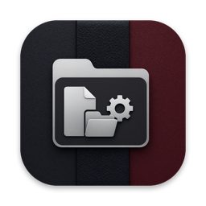

<h1 align="center">OneRoot</h1>

A fast, native file manager for macOS, built for real file work.

<a href="https://github.com/hillcraft-sc/OneRoot/releases/latest"><b>Download the latest release</b></a>

---

OneRoot keeps browsing calm and familiar, and puts the power tools one click
away when you need them:

- **Tabs** that remember where you were, and **multiple windows**
- A **folder tree** rooted where you're working, next to a sortable,
  customizable **file list**
- **Breadcrumbs** you can click, or type a path straight into
- An **Inspector** with a large preview, details, permissions, and tags
- **Cut, copy, paste**, with progress, Cancel, and **Undo**
- **Dual Pane**: two folders side by side, F5/F6 to copy or move between them
- **Workspaces**: one place for a project's folders, wherever they live
- **Search** that filters the current folder or searches everything, with
  name, kind, date, size, tag, and content filters
- **Quick Actions**: resize and convert images, combine into PDF, convert
  documents, batch rename, compress and extract
- **Visualize** what's using your storage
- Network shares, external drives, iCloud Drive and other cloud folders
- Light and dark themes, and a searchable built-in Help

## Install

1. Download `OneRoot-x.y.z.dmg` from [Releases](https://github.com/hillcraft-sc/OneRoot/releases/latest).
2. Open it and drag **OneRoot** onto the **Applications** folder.
3. Open OneRoot. macOS asks once whether to open an app downloaded from the
   internet: click **Open**.

OneRoot is signed with Developer ID and notarized by Apple.

On first launch OneRoot shows you how to give it **Full Disk Access**, which it
needs to browse all your files the way Finder can. You only do this once;
updates keep the permission.

**Requires** macOS 14 Sonoma or later, on Apple silicon or Intel.

## Feedback

Found a bug or have an idea? [Open an issue](https://github.com/hillcraft-sc/OneRoot/issues).

## License

OneRoot is free for **noncommercial** use: personal use, and use by
charities, schools, public research, and government organizations. It may
not be redistributed, modified, or used commercially without a separate
license. See [LICENSE](LICENSE) (PolyForm Strict 1.0.0); for commercial use,
contact Eric Hebert. OneRoot is not open source, and this repository holds
releases only.

© 2026 Eric Hebert. "OneRoot" and its icon are not licensed for others' use.
